<div align="center">



<br>


### Find every failed Windows update. Name the cause. Apply the approved fix. Prove it landed.

**[Features](#-features)** · **[How it runs](#-how-it-runs)** · **[Guardrails](#%EF%B8%8F-guardrails)** · **[Results](#-results-in-production)** · **[Roadmap](#%EF%B8%8F-roadmap)** · **[FAQ](#-faq)** · **[Get FastPatch](#-get-fastpatch)**

</div>

---

## 😩 The problem

Every MSP knows patch night. Kaseya says a few dozen machines failed. Someone exports them to a spreadsheet, logs into each one, guesses the cause, retries, and leaves a ticket note that only they can read. The next engineer starts from scratch.

**FastPatch moves that whole loop onto the Kaseya agent you already run.** Your engineers stop hunting for problems and start reading a short list of exceptions that already say what went wrong.

## ✨ Features



## 🔁 How it runs


| Step | What happens |
|:-:|---|
| **01 · Schedule** | Kaseya runs a signed procedure for one machine group at a time |
| **02 · Run on the agent** | Five checks, then the approved fix for whatever they find |
| **03 · Result line** | Each machine reports its status, the cause and the action taken |
| **04 · Branch and log** | Kaseya routes every result by status and keeps the logs |
| **05 · Verify** | After your normal restart window, FastPatch confirms the update really installed |

### 🩺 The five checks

Every machine gets the same five timestamped checks before anything is changed.

| Check | Why it matters |
|---|---|
| 🧱 **Component store** | A damaged component store blocks updates from installing |
| 🔄 **Pending reboot** | An unfinished restart holds the next update back |
| 🧰 **Servicing stack** | An outdated servicing stack can't apply newer updates |
| 🔢 **Update error code** | The error Windows Update reported points to the cause |
| 💾 **System volume** | Too little free space on the system drive stops the install |

## 🛡️ Guardrails


## 🚦 Every machine gets an answer


When FastPatch can't finish a machine, it never fails silently. It hands the machine back with one of five labels, so nobody has to work out what happened.

## ⚖️ Before and after

| Step | 😩 Before | ⚡ With FastPatch |
|---|---|---|
| Find failures | Export to a sheet, filter and clean by hand | Read straight from Kaseya patch status |
| Choose machines | Judged one by one from the sheet | Eligibility checked by rules on the machine |
| Diagnose | Log in and run the checks manually | Five checks on the agent, each timestamped |
| Name the cause | Depends on who picks it up | One reason from a shared vocabulary |
| Fix | Ad hoc, then retry | The approved path for that reason |
| Prove it landed | "The job ran" | The update is present after the restart |
| Report | Free-text ticket notes | A ticket-ready line: cause plus action |

## 📈 Results in production

| 🖥️ Machines patched | ✅ Success rate | 📏 Fleet size |
|:-:|:-:|:-:|
| **600+** across client fleets | **99%** patched cleanly, the rest handed back with a named cause | **10 → 100+** machines on the same flow |

## 🗺️ Roadmap

| | Item | Status |
|:-:|---|---|
| 🪟 | Windows patch remediation through Kaseya VSA | ✅ Live in production |
| 🍎 | macOS support | 🔜 Next build |
| 🔁 | Reboot proof | 📝 Planned |
| 📊 | Central result collection | 📝 Planned |
| 🩺 | Health checks | 📝 Planned |

## ❓ FAQ

<details>
<summary><b>Will FastPatch restart our machines?</b></summary>
<br>
No. Your maintenance window restarts machines, on your schedule. FastPatch only checks afterwards that the update really installed.
</details>

<details>
<summary><b>Do we have to install anything new?</b></summary>
<br>
No new app goes on your machines. FastPatch runs inside the Kaseya VSA you already have, as a signed procedure scheduled per machine group.
</details>

<details>
<summary><b>Will it change our Windows Update settings or policy?</b></summary>
<br>
No. It works with whoever manages updates today and never rewrites update policy.
</details>

<details>
<summary><b>What happens when it can't fix a machine?</b></summary>
<br>
The machine comes back with one of five labels: fixed itself, try again later, waiting for a restart, needs a decision, or needs an engineer. Your NOC works those exceptions only.
</details>

<details>
<summary><b>Who approves the fixes?</b></summary>
<br>
You do. FastPatch applies only the approved path for each cause, inside your approval policy, and rolls out one machine group at a time.
</details>

<details>
<summary><b>How large a fleet can it handle?</b></summary>
<br>
It runs the same flow on 10 machines or 100+, and has patched 600+ machines in production so far.
</details>

<details>
<summary><b>Does it support Macs?</b></summary>
<br>
macOS support is the next build on the roadmap.
</details>

<details>
<summary><b>How was it built?</b></summary>
<br>
FastPatch was designed and built with Claude as a design partner. People review and approve every production release.
</details>

More detail lives in [`docs/`](docs).

## 🚀 Get FastPatch

FastPatch is closed source and offered to MSPs directly. The quickest way to see it is a live demo on a Kaseya console, followed by a pilot on one of your machine groups.

<div align="center">

<a href="mailto:rehank9540@gmail.com?subject=FastPatch%20demo"></a>
<a href="mailto:rehank9540@gmail.com?subject=FastPatch%20pilot%20for%20our%20MSP"></a>

</div>

## 📁 What's in this repo

```
fastpatch/
├── README.md            you are here
├── docs/
│   ├── how-it-works.md  the run loop and the five checks in detail
│   ├── guardrails.md    what FastPatch will never do, and the five outcomes
│   └── faq.md           answers for MSP owners, NOC leads and security teams
├── assets/              README graphics (animated SVG)
├── tools/
│   └── build_assets.py  regenerates every graphic in assets/
├── CHANGELOG.md
├── SECURITY.md
└── LICENSE.md
```

This repository is the public home of FastPatch: documentation and product information. The FastPatch engine itself is not distributed here.

---

<div align="center">
<sub>Built by <a href="https://github.com/rehan-123">Rehan Khan</a> · The run log in the header graphic is illustrative, with made-up host names · Kaseya and Kaseya VSA are trademarks of Kaseya Limited; FastPatch is not affiliated with Kaseya.</sub>
</div>
