# Auto-rollback (new, beta)

A patch can install cleanly and still break a machine. Auto-rollback catches that after your restart window and removes the update that caused it, without breaking any FastPatch guardrail.

## How it works

1. **Baseline, before the patch.** FastPatch records the installed updates, the auto-start services that are running, and the time.
2. **Patch as usual.** Your maintenance window restarts the machine.
3. **Health check, after the restart.** After a short grace period (10 minutes by default) the machine is compared with its baseline.
4. **Healthy:** nothing to do. The run reports *Fixed itself*.
5. **Unhealthy, and an update landed:** FastPatch stages removal of **only the new update(s)** with no restart, and reports *Waiting for a restart*.
6. **After the next restart window:** if the update is gone and the machine is healthy, the run reports *Rolled back* and names the KB to deny in your approval policy.

## What counts as unhealthy

| Signal | Example |
|---|---|
| A service that was running before the patch is down | Print Spooler stopped after the update |
| A service you marked as required is down | SQL Server or a line-of-business service |
| Windows crashed since the patch | Unexpected shutdown or bugcheck in the System log |

Services that start and stop on their own (update services, trigger-start services) are ignored, and each client can add their own to the ignore list.

## Guardrails

| Rule | How rollback keeps it |
|---|---|
| Never restart your machines | Removal is staged with no restart and completes in your restart window |
| Never change Windows Update settings | It doesn't hide or block updates; it tells you which KB to deny in your policy |
| Never delete Windows repair files | No component cleanup and no ResetBase |
| Never loop without a limit | One rollback attempt per update |
| Never say "success" without proof | *Rolled back* only after a restart shows the update gone and the machine healthy |

## When it hands over instead

| Situation | Outcome |
|---|---|
| Unhealthy, but no new update to blame | Needs an engineer |
| The new update is a servicing stack update (can't be removed) | Needs an engineer |
| Removal failed | Needs an engineer |
| Still unhealthy after a rollback | Needs an engineer (the update wasn't the cause) |
| No baseline was taken for this patch run | Needs a decision |

## Platform

Windows only. Apple doesn't support removing installed macOS updates.
