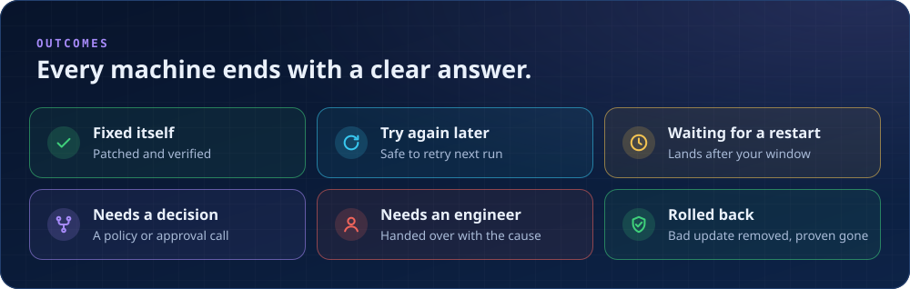

# Guardrails

## What FastPatch will never do

| Never | What happens instead |
|---|---|
| **Restart your machines** | Your maintenance window restarts them, on your schedule |
| **Change Windows Update settings** | It works with whoever manages updates today |
| **Delete Windows repair files** | It repairs; it never wipes |
| **Touch antivirus or security tools** | Your security stack stays exactly as it is |
| **Loop without a limit** | One search, one download, one install per run |
| **Say "success" without proof** | Done means the update is installed after the restart |

## The six outcomes

Every machine ends a run with exactly one of these labels:

| Outcome | Meaning |
|---|---|
| ✅ **Fixed itself** | The update is installed and verified |
| 🔁 **Try again later** | Nothing is wrong that needs a person; the next run picks it up |
| ⏳ **Waiting for a restart** | The fix is in place and lands after your restart window |
| 🔀 **Needs a decision** | The next step needs a policy or approval call |
| 🧑‍🔧 **Needs an engineer** | Handed to a person, with the cause already named |
| 🛡️ **Rolled back** | A bad update was removed and proven gone after the restart ([auto-rollback](auto-rollback.md)) |
