# How FastPatch works

FastPatch runs inside Kaseya VSA. It adds no new app to your machines: Kaseya schedules it, the Kaseya agent runs it, and Kaseya keeps the logs.

## The six stages on each machine

| Stage | What it does |
|---|---|
| **Detect** | Picks up machines with failed or missing patches from Kaseya patch status |
| **Diagnose** | Runs five checks on the agent and timestamps each result |
| **Classify** | Maps the evidence to one reason from a shared vocabulary |
| **Remediate** | Applies the path for that reason, inside the client's approval policy |
| **Verify** | Confirms the update is installed after the restart, not only that a job ran |
| **Report** | Writes a ticket-ready line: the reason and the action taken |

## The five checks

1. **Component store.** Is the Windows component store healthy enough to install updates?
2. **Pending reboot.** Is an unfinished restart holding the next update back?
3. **Servicing stack.** Is the servicing stack current enough to apply newer updates?
4. **Update error code.** What error did Windows Update report, and what does it point to?
5. **System volume.** Is there enough free space on the system drive to install?

Every result is timestamped, so an engineer reading the ticket sees what was true on the machine and when.

## Rollout and release control

- Each FastPatch release is approved before it reaches production.
- Kaseya runs it for **one machine group at a time**, so a new release meets a small group first.
- Your **approval policy** decides which fixes are allowed. FastPatch never goes outside it.

## What the NOC sees

Instead of a spreadsheet of failures, the NOC gets one result line per machine (status, cause, action) and works only the exceptions. Every exception already carries one of the [five outcome labels](guardrails.md#the-five-outcomes).
